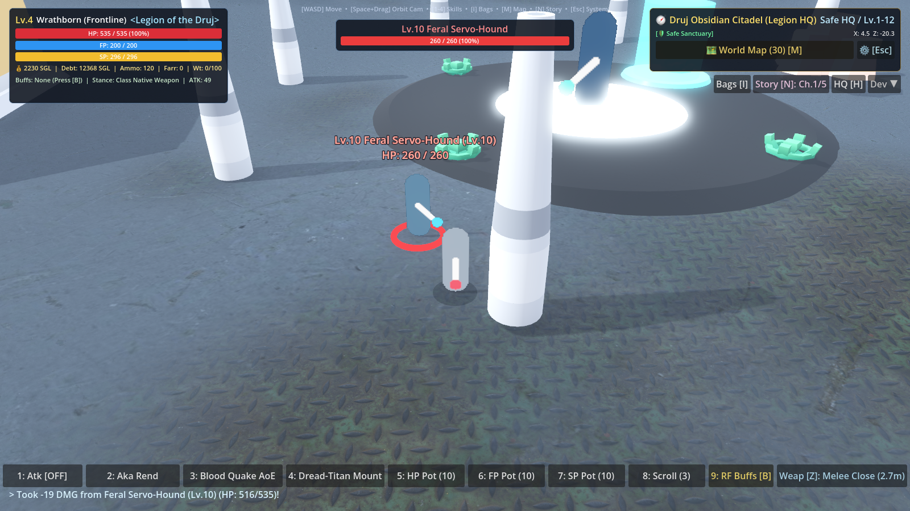
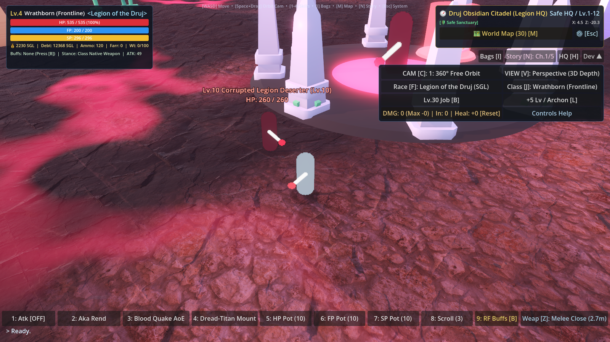
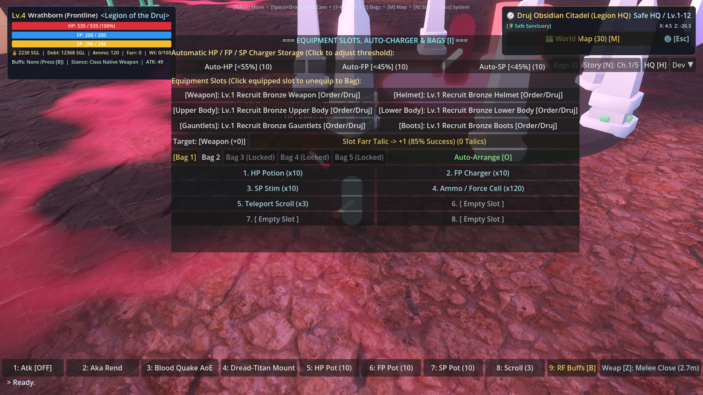
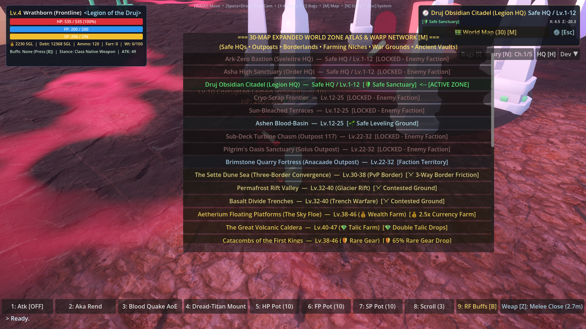

# HUD Layout Redesign Specification & Architecture

This document details the reformed in-game HUD layout in Godot 4, transitioning from the oversized legacy Top-Right Economy box to an authentic, uncluttered MMORPG layout inspired by classics like *RF Online*, *World of Warcraft*, and *Final Fantasy XIV*.

---

## 1. Overview of Layout Reformation

```
+-----------------------------------------------------------------------------------------------------------------------+
| [ TOP-LEFT: PLAYER UNIT FRAME ]                                                          [ TOP-RIGHT: ZONE & MAP ]    |
| +---------------------------------------------------------+                              +--------------------------+ |
| | Lv.4 Wrathborn (Frontline) <Legion of the Druj> [ARCHON]|                              | 🧭 Druj Obsidian Citadel | |
| | HP [==============================] 535 / 535 (100%)    |                              | Safe HQ / Lv.1-12        | |
| | FP [==============================] 200 / 200            |                              | [🛡️ Safe Sanctuary]      | |
| | SP [==============================] 296 / 296            |                              | Coords: X: 4.5  Z: -20.3 | |
| | 💰 2,230 SGL  |  Debt: 12,368 SGL  |  Ammo: 120         |                              | [🗺️ World Map (30) [M]]  | |
| | Buffs: RF +22% [115s]  |  Stance: Native (2.7m)         |                              +--------------------------+ |
| +---------------------------------------------------------+                              | [I][Story N][HQ H][Dev ▾]| |
|                                                                                          +--------------------------+ |
|                                                                                                                       |
|                                            [ TOP-CENTER: TARGET FRAME ]                                               |
|                                            +--------------------------+                                               |
|                                            | Lv.10 Feral Servo-Hound  |                                               |
|                                            | [======================] |                                               |
|                                            | HP: 260 / 260 (100%)     |                                               |
|                                            +--------------------------+                                               |
|                                                                                                                       |
|                                              (WIDE-OPEN 3D VIEWPORT)                                                  |
|                                                                                                                       |
|                                                                                                                       |
|                                                                                                                       |
|                                                                                                                       |
| [ BOTTOM-LEFT: COMBAT LOG ]                           [ BOTTOM-CENTER: ACTION BAR ]                                   |
| > Took -19 DMG from Feral Servo-Hound (Lv.10)!        [1:Atk][2:Cleave][3:AoE][4:Mount] [5:HP][6:FP][7:SP][8:Scroll]  |
| > Ready.                                              [9: RF Buffs [B]]  [Weap [Z]: Melee Close (2.7m)]               |
+-----------------------------------------------------------------------------------------------------------------------+
```

---

## 2. Key Panels and Components

### A. Top-Left Player Unit Frame (`PlayerPanel`)
- **Location**: `offset_left = 16.0, offset_top = 14.0, offset_right = 380.0, offset_bottom = 182.0`.
- **Visual Styling**: Dark semi-transparent sci-fi glass panel (`Color(0.06, 0.08, 0.12, 0.88)` with cyan/slate border `Color(0.25, 0.38, 0.52, 0.75)` and `corner_radius = 6`).
- **Header**:
  - `LevelBadge`: Gold pill showing `Lv.1` to `Lv.50`.
  - `NameLabel`: Active class / character title (`Wrathborn (Frontline)`, `Breaker`, `Striker`, etc.).
  - `FactionLabel`: Active race tag (`<Legion of the Druj>`, `<Sveleitre>`, `<Order of the Oracle>`).
  - `LeaderTag`: Illuminated gold badge `[ARCHON]` when faction leader.
- **Vital Bars**:
  - **HP Bar**: Rich Crimson Red fill (`Color(0.86, 0.18, 0.22)`), background `Color(0.10, 0.12, 0.16, 0.90)`, overlay text: `HP: 535 / 535 (100%)`.
  - **FP Bar**: Cerulean Cyan fill (`Color(0.18, 0.58, 0.95)`), overlay text: `FP: 200 / 200`.
  - **SP Bar**: Warm Golden Amber fill (`Color(0.95, 0.74, 0.18)`), overlay text: `SP: 296 / 296`.
- **Wallet & Economy Footer**:
  - `WalletLabel`: Unified live display of wallet credits, faction debt, ammo cells, and bag weight.
- **Status Subtitle**:
  - `StatusLabel`: Real-time active buffs (`RF Buffs +22% [115s]`), active weapon stance (`Native`, `Exile Shamshir`, `Siege Art`), and base attack power (`ATK: 49`).

---

### B. Top-Right Zone Navigation & Minimap Frame (`ZoneNavPanel`)
- **Location**: `offset_left = -310.0, offset_top = 14.0, offset_right = -16.0, offset_bottom = 126.0`.
- **Footprint**: Reduced from old `560px` down to `294px` wide x `112px` high—over **65% reduction in screen coverage**.
- **Visual Styling**: Dark glass with ancient Persian burnished gold border (`Color(0.55, 0.45, 0.22, 0.85)`).
- **Contents**:
  - **Zone Header**: Compass icon (`🧭`) + Zone Title (e.g. `Druj Obsidian Citadel (Legion HQ)`) + Level Band (`Safe HQ / Lv.1-12`).
  - **Zone Metadata**: Farming focus badge (e.g. `[🛡️ Safe Sanctuary]`, `[⛏️ Core 3-Way Ore Mining]`, `[💎 Double Talic Drops]`, `[🏰 Vault: 1.5x XP]`).
  - **Live GPS Coordinates**: Real-time player position updated every frame: `X: 4.5  Z: -20.3`.
  - **Action Buttons**:
    - `🗺️ World Map (30) [M]`: Opens the complete 30-Map Atlas & Warp Network.
    - `⚙️ [Esc]`: Opens Audio, Targeting, and Camera options.

---

### C. Menu Tray & Collapsible Developer Drawer (`MenuTray` & `DevPanel`)
- **Menu Tray**: Positioned directly underneath the Zone frame (`offset_top = 132.0, offset_bottom = 164.0`).
  - `Bags [I]`: Toggles 5-Bag Inventory, Equipment slots, and Auto-Chargers. Opens cleanly at `x = 390` without obscuring the Player Unit Frame.
  - `Story [N]`: Toggles 5-Chapter Sovereign Campaign and Illustrated Lore Codex.
  - `HQ [H]`: Instant recall warp to faction headquarters.
  - `Dev ▼`: Toggles the developer drawer.
- **Collapsible Developer Drawer (`DevPanel`)**:
  - Collapsed by default so normal gameplay has zero developer clutter.
  - When expanded, shows a tidy 2-column grid:
    - `CAM [C]: 360° Free Orbit / Over-the-Shoulder / Fixed Isometric / Drone`
    - `VIEW [V]: Perspective (3D Depth) / Orthographic`
    - `Race [F]: Fast switch between Sveleitre, Legion, and Order`
    - `Class [J]: Fast class cycle`
    - `Lv.30 Job [B]: Job specialization toggle`
    - `+5 Lv / Archon [L]: Instant level booster`
    - `Reset Meter: Combat telemetry DPS/Heal reset`
    - `Controls Help: Toggle keybinding hint banner`

---

### D. Enemy Target Frame (`TargetPanel`)
- **Location**: Top-center (`offset_left = -210.0, offset_top = 34.0, offset_right = 210.0, offset_bottom = 90.0`).
- **Visibility**: Appears only when a hostile mob or boss is targeted.
- **Contents**:
  - `TargetLabel`: Clean enemy name without redundant level tags (e.g. `Lv.10 Feral Servo-Hound`).
  - `TargetBar`: Menacing boss-red progress bar with centered health text overlay (`260 / 260 (100%)`).

---

## 3. Rendered Verification Screenshots

````carousel

<!-- slide -->

<!-- slide -->

<!-- slide -->

````
