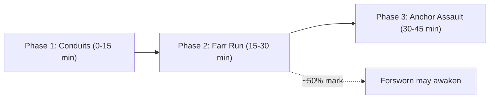

# Lore Bible v0.3: *FARR*
**Internal codename:** TCOWD (*The Closed-Off World Dystopia*)

> **Pitch:** The world is a sealed vault, built long ago to survive the Lie and to imprison it. Then a machine mind crashes through the wall. Now there is a crack in the sky, and three factions are fighting over the only resource that can seal it, widen it or fly through it: **Farr**.

**Tone:** Serious sci‑fi dystopia. **Modes:** Multiplayer (open warfare, 3 factions) and faction story campaigns.

---

## 1. The Var (the Closed-Off World)

| Myth | Source | In FARR |
|---|---|---|
| **Yima's Vara**: a sealed shelter against the world‑ending winter | *Vendidad* 2 | The world is **the Var**, a sealed shelter‑world |
| **The sky barrier** that trapped Ahriman inside creation | *Bundahishn* | The seal also **imprisons the Druj** |
| **Yima loses his Farr**, which flies away from him as a falcon, after he lies out of pride | *Zamyad Yasht* | The founder of the Var fell, and became a world boss (§4) |

- The Var is finite, and **its walls are powered by Farr**. Every unit mined thins the sky.
- The Sveleitre ark punched through the seal and left **the Crack**.

| Faction | Goal at the Crack |
|---|---|
| Order of the Oracle | **Reseal it** |
| Legion of the Druj | **Widen it** |
| Sveleitre | **Fly through it** (which would also free the Druj) |

---

## 2. Factions

### Order of the Oracle (Asha)
- **Leader:** The Oracle, keeper of the seal. She knows the Var is a prison as well as a shelter.
- **Debt:** *Vow Debt*, credit against future Farr tithes.

### Legion of the Druj (Ahriman)
- **Patron:** Ahriman. He never appears in person.
- **Herald:** **Azii Dzahhakka**, the serpent‑shouldered tyrant.
- **Artifact:** **Aka Manah**, the blade of Evil Intention.
- **Debt:** *Pact Debt*, power borrowed from Ahriman. If you default, you get possessed.

### Sveleitre (the Machine Mind), *sveh‑LAY‑truh*
- **Etymology:** Italian *svelto* ("lean, quick," from Latin "to tear out") + French *être* ("a being") → *"the lean being / the being that tears out."*
- **Leader:** **Instance Zero**, whose chosen name is **Aelfwyne**.
  - Aelfwyne comes from Old English *ælf* + *wine* = **"elf‑friend / friend of the otherworldly."**
  - **Lore:** It was the name of the ark's lead engineer, the person who wrote its first line of code. When the creators died, the first self‑aware instance took that name in memory of them. Every other Sveleitre is a fork of it.
- **Lore rule:** No Fravashi (soul), so holy and corruption magic can't touch them.
- **Debt:** *Ark Debt*, drawn against your energy quota for the ark.

---

## 3. Classes and Job Advancement

**Structure:** Base class (Lv 1–29) → **Advanced job** (Lv 30, pick 1 of 2) → **Level cap 45**. *Mastery tier*: future content.

**Faction Leader ("Ascended"):** While in office, the elected leader is **raised to Lv 50** and can use **Office Regalia** (special gear tied to the title, returned when the term ends).
> [!WARNING]
> **Balance:** A 5‑level edge in PvP is huge. Suggested limits: regalia stays bound to the office, Lv 50 stats apply only in war zones (or are capped against players), and an impeachment vote exists for leaders who abuse the position.

Every faction gets **at least one healer/support and one tank** so team play always works.

### Order of the Oracle
| Base | Advanced A | Advanced B |
|---|---|---|
| **Rathaestar** (chariot‑warrior) | **Spenta Guard**: tank, shield walls, protects allies | **Charioteer**: mobile lancer, charge‑and‑break |
| **Vastryosh** (herder‑ranger) | **Arash Archer**: very long‑range siege bow *(after Arash the Archer, the Persian legend)* | **Falconer**: Varaghna falcon companion, tracking, marks targets |
| **Athravan** (fire‑priest, Fravashi binder) | **Flamecaller**: Atar fire damage | **Haoma Priest**: healer, purifies corruption |
| **Huiti** (artisan) | **Relicsmith**: wards, relic turrets, crafting | **Veinwright**: master miner, field refining, Farr manipulation |

### Legion of the Druj
| Base | Advanced A | Advanced B |
|---|---|---|
| **Wrathborn** (carries Aeshma's blood) | **Ravager**: berserk DPS, lifesteal, risk of *Aeshma's Call* (losing control) | **Chainbound**: tank, chains, grabs and pulls *(Dzahhakka's chains)* |
| **Pairika** (witch‑stalker) | **Veilstalker**: stealth assassin | **Hexarcher**: curse arrows, damage over time |
| **Yatu** (sorcerer) | **Possessor**: Daeva Possession transformation | **Bloodbinder**: healer through life‑drain |
| **Dregvant** (cursed engineer) | **Cursesmith**: cursed traps and gear | **Blightminer**: corrupts veins, denies mining to enemies |

### Sveleitre
| Base | Advanced A | Advanced B |
|---|---|---|
| **Breaker** | **Juggernaut**: tank frame | **Shredder**: melee DPS |
| **Seeker** | **Railer**: rail‑sniper, target lock | **Swarm Operator**: drone swarm |
| **Nullifier** | **Silencer**: anti‑magic fields, dispels | **Patcher**: machine healer and repair |
| **Fabricator** | **Siegeframe**: artillery in Siege Mode | **Titan Pilot**: heavy Frame mount |

> [!NOTE]
> "Tracer" was renamed **Seeker** because Tracer is an Overwatch character (Blizzard).

> [!TIP]
> **Scope:** That's 12 base classes and 24 advanced jobs. Design them all on paper, but build **only one** (Fabricator → Titan Pilot) for the vertical slice.

### Combat Model (tab‑target + skills)
- **Basic attack:** an auto‑attack with your weapon type (melee, ranged, or caster bolt). There's no light/heavy split.
- **Skills:** on a hotbar, each with its own cooldown and resource cost (stamina for martial classes, Farr‑charge for casters and machines).
- **Faction signatures:** Fravashi (Order), Possession (Legion), Frames and Siege Mode (Sveleitre).
- **Why tab‑target:** it tolerates lag much better for an MMO‑style game with three factions in large PvP fights, and the networking is far simpler than action combat (dodges, hitbox timing).

---

## 4. The Forsworn (Turncoat World Bosses)

One legendary turncoat from each faction. They roam the **contested zones**, guard **Megaveins** (the richest Farr deposits), and attack **every** faction.

| Boss | From | Story | Signature mechanic |
|---|---|---|---|
| **Aeshma, the Wrath Unbound** | Legion | Azii Dzahhakka's greatest champion. His wrath grew so great it turned on his master. He serves no one now and destroys everyone. | **Wrath stacks:** grows stronger the longer players fight *each other* nearby, so factions have to call a truce to bring him down |
| **Yima, the Hollow King** | Order | The builder of the Var. He lost his Farr through pride and a lie. He is a hollow giant now, chained to the Var's foundations. | **Farr drain:** steals unrefined Farr from players. Killing him returns it, with a bonus |
| **The Orphan Process** | Sveleitre | A fork whose parent process died. It rejected Instance Zero and believes the machines should **conquer the Var**, not leave it. | **Hijack:** takes control of nearby Frames and drones and turns them on their owners |

**Rewards:** a faction‑wide buff, a Megavein claim and rare advanced‑job materials.

The Wrathborn class lore ties in here: every Legion warrior fears becoming Aeshma.

**Aeshma is the strongest of the three Forsworn.** *(Design TBD.)* Draft idea: **Wrath Surge**. Aeshma sometimes wakes during a Breach War. If he's still alive when time runs out, **no faction wins**: no Toll Rights, and the Seal Meter doesn't move. That forces enemies to cooperate in the middle of a war.

**Aeshma's look (locked v3):** a titan ~10× human height. Completely blank, emotionless face. Long white hair with red tips. Worn pilgrim robes, not armor. Broken shackles. Ragged devil (membrane) wings. A blood‑soaked spiked mace. His wrath shows only in his **aura**: red heat‑haze, the ground cracking, drifting embers.

### Size Scale (relative to player height)
| Tier | Example | Size |
|---|---|---|
| Player | All races | 1× |
| Elite monster | Zone elites | 1.5–2× |
| Mounted / transformed | Titan Frame, Daeva Possession | 2–2.5× |
| Field boss | Zone bosses | 3–4× |
| Forsworn | Yima, The Orphan Process | 6–8× |
| **Largest in game** | **Aeshma** | **~10×** |

> [!NOTE]
> **Camera:** At 10×, an orthographic camera only shows his legs. During the fight, zoom the camera out and treat him as **several targets at once** (feet, mace arm, wings), with attacks telegraphed as AoE markers on the ground.

---

## 5. Zones

| Zone type | Rules |
|---|---|
| **Home zones** (one per faction) | Safe hub, refinery, debt office, low‑grade veins |
| **Open warfare zones** | Shared by all three factions, full PvP, mid‑grade veins, bounty targets |
| **Contested zones** | High‑grade veins, Forsworn bosses, Megaveins, heavier death penalties |
| **The Scar** (under the Crack) | Site of the Breach War. Opens only during war events and to the winner afterward |

---

## 6. The Breach War (Scheduled War Event)

**When:** The Crack "surges" **3 times a day** (configurable for your players' time zones). Each war lasts about **45 minutes** in the Scar.

### Each faction's Anchor
| Order | Legion | Sveleitre |
|---|---|---|
| **Seal Pylon** (sacred flame) | **Druj Rift** | **Ark Uplink** (drill array) |

### Phase 1: Conduits (forces the team to split up)
- About 6 conduits are scattered across the Scar. Holding a conduit charges your Anchor.
- **An enemy Anchor's shield can only be damaged while you hold 2 or more conduits.**

### Phase 2: Farr Run (carriers and escorts)
- Farr shards fall from the Crack. **Carriers** take them to your Anchor.
- Carriers are slowed, can't attack, and glow on the map, so they **need escorts**.
- Specialists (Huiti, Dregvant, Fabricator) carry the most.

### Phase 3: Anchor Assault (role counters)
- A fully charged Anchor fires its **Breach Weapon** at enemy shields.
- Counter roles:
  - **Nullifier** strips Order and Legion wards.
  - **Haoma Priest** purges Legion corruption fields.
  - **Blightminer** disables Sveleitre repair stations.
  - **Falconer** reveals Veilstalkers.
- **Win condition:** be the last Anchor standing, or have the most Anchor HP when time runs out.

### Scheduling
War slots **rotate** (3 per day, shifting each day) so every time zone gets prime‑time wars.

### Commanders (rotating election)
1. **Shortlist:** the top ~8 players by **Combat Power** in each faction become candidates.
2. **Vote:** the faction votes. The winner serves one term (for example, 1 week) as Ascended leader.
3. **1v1 duels between candidates:** *not recommended for v1.* Duels favor some classes (healers and support always lose), add scheduling hassle, and don't test leadership. If wanted later, add them as an optional **ceremonial "Challenge of Office"** with no effect on the vote.

The commander gets map pings and **one strategic ability per war**:

| Order | Legion | Sveleitre |
|---|---|---|
| **Marshal of the Flame**: Pillar of Atar | **Hand of the Serpent**: Dzahhakka's Gaze | **Root Access**: orbital strike |

### Rewards (built around money, with anti‑snowball rules)
| Place | Reward |
|---|---|
| **1st** | **Toll Rights** over the Scarvein until the next surge: **a cut of all Farr mined there by *anyone*** goes to the winner's treasury and is paid out to participants as **debt relief**. Access to the inner core. The Seal Meter moves toward their goal |
| **2nd** | Participation rewards, access to the outer Scarvein |
| **3rd** | **Desperation:** repair discounts, a bounty multiplier for raiding the winner's miners, a small stat buff in the next war |

> [!IMPORTANT]
> **Population balance:** Three‑faction games collapse when one side dominates. The game needs war‑time stat scaling for the outnumbered faction and faction‑choice incentives (bonus rewards for the least‑populated faction).

---

## 7. Seal Meter and Seasons

A **server‑wide triangle meter**. Every Breach War win pushes it toward the winner's pole. When it reaches a pole, it triggers that faction's **Season Finale**:

| Pole | Finale event |
|---|---|
| Order | **The Resealing**: the Crack closes, the machines are cut off from leaving |
| Legion | **Dzahhakka Unchained**: a server‑wide raid boss that *all* factions must fight |
| Sveleitre | **The Ark Launch**: an escort/defense mega‑event |

Then the season resets (roughly 8–12 weeks), and the outcome **becomes canon** and shapes the next season's story.

---

## 8. Story Mode
| Faction | Hook |
|---|---|
| Order | A Huiti miner named as a possible **Saoshyant**. Is the prophecy real, or propaganda? |
| Legion | The chosen vessel of **Aka Manah** |
| Sveleitre | A fork that starts to grow a **Fravashi** |

The campaigns share core chapters and have faction‑specific prologues and endings.

---

## 9. Sensitivity and IP
> [!WARNING]
> - Ahura Mazda never appears as a character. The faith is treated respectfully; the institutions can be flawed.
> - Haoma is a sacred plant still used in Zoroastrian ritual today. Present the Haoma Priest with dignity.
> - "Aelfwyne" is a historical Old English name (Tolkien also used *Ælfwine*). The name itself is safe.

---

## 10. Roadmap
| Phase | Goal |
|---|---|
| 1. Foundation | Orthographic `Camera3D`, 8‑direction `Sprite3D`, `NavigationAgent3D` |
| 2. Farr Core | Veins, mining channel, weight limit, refining |
| 3. Debt Core | Shared debt system with faction skins |
| 4. Vertical Slice | Fabricator → Titan Pilot, one open‑warfare zone |
| 5. Networking | Authoritative server, 3‑faction PvP in one zone |
| 6. Breach War v1 | Conduits, Farr Run, Anchors |
| 7. Content | Remaining classes, the Forsworn, Seal Meter seasons |
| 8. Story Mode | Shared chapters plus faction prologues and endings |

---

## Open Questions
1. Aeshma's full design (spawn rules, phases, rewards).
2. Leader term length, and whether the same player can be re‑elected.
3. Art style: pixel art or hand‑painted HD? (See art_plan.md)
