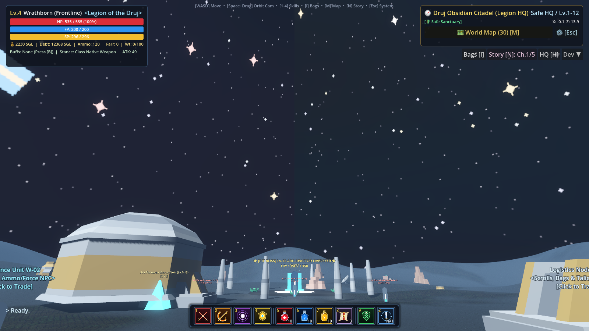
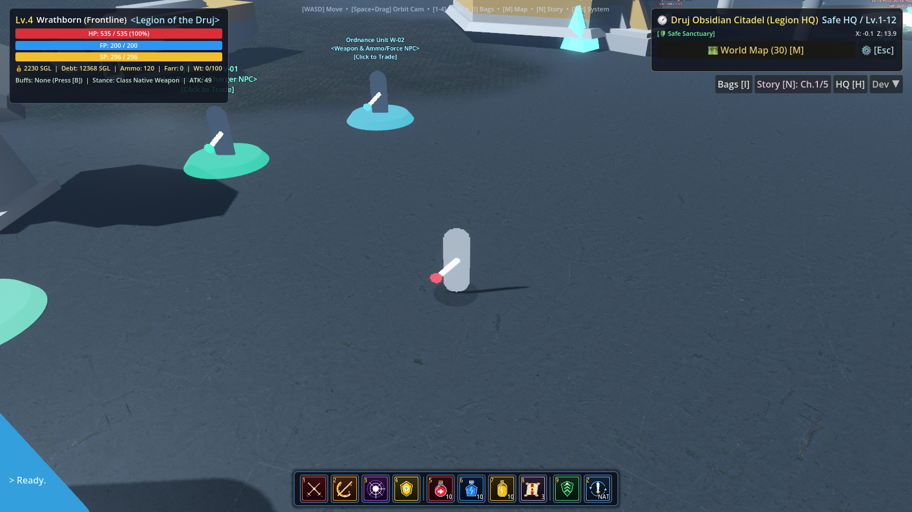

# RF Online Quickskill Bar & Cosmic Starry Sky Overhaul

## 1. Overview
In response to your feedback:
1. **Sky Overhaul**: Removed all washed-out earth overcast skies across all 30 maps. Replaced with 5 high-fidelity Poly Haven night starfield HDRIs and 3 custom 2048x1024 360° cosmic starfield panoramas featuring the celestial crack, violet nebulae, and cyan auroras. Set `fog_sky_affect = 0.05` to prevent fog from washing out stars.
2. **Bottom Menu / Quickskill Bar**: Replaced the wide, text-heavy action buttons stretching across the bottom of the screen with a classic **RF Online-style boxy quickskill bar**:
   - Compact `50x50` square metallic slots centered at the bottom of the screen.
   - Dedicated picture icons for each skill, potion, and utility.
   - Hotkey badges `[1-9, Z]` in the top-left corner.
   - Consumable stack count badges (`10`, `3`) or stance badges (`NAT`, `FAST`, `POW`) in the bottom-right corner.
   - Semi-transparent cooldown overlay sweep with countdown timer (`%.1fs`).
   - Active neon border highlights for auto-attack, signature mode, and buff suite.
   - Rich multi-line tooltips on hover.

---

## 2. In-Game Screenshots

### Starry Cosmic Sky + RF Quickskill Bar

### Quickskill Bar Closeup & HUD Geometry

---

## 3. Quickslot Slot Mapping

| Slot | Key | Icon Graphic | Function / Description | Dynamic State |
| :---: | :---: | :--- | :--- | :--- |
| **1** | `1` | Crossed energy blades | **Auto-Attack**: Toggles basic attack loop on current target | Orange border + `ON` badge when active |
| **2** | `2` | Sweeping crescent blade | **Class Burst / Cleave**: Primary combat skill (180% damage) | Cooldown veil + countdown (`%.1fs`) |
| **3** | `3` | Shockwave ground burst | **AoE Stomp**: Shockwave staggering nearby enemies | Cooldown veil + countdown (`%.1fs`) |
| **4** | `4` | Golden Mech Titan crest | **Signature Mode**: Faction Siege Stance / Fravashi summon | Gold border + `ON` badge when active |
| **5** | `5` | Ruby health flask | **HP Potion**: Restores +350 HP instantly | Stack count badge (`10`) + shared 2s CD |
| **6** | `6` | Sapphire force crystal | **FP Potion**: Restores +250 FP instantly | Stack count badge (`10`) + shared 2s CD |
| **7** | `7` | Golden stamina ampoule | **SP Potion**: Restores +300 SP instantly | Stack count badge (`10`) + shared 2s CD |
| **8** | `8` | Ancient runic scroll | **Recall Scroll**: Warps back to Faction Safe HQ | Stack count badge (`3`) |
| **9** | `9 / B` | Ascending buff shield | **RF Buff Suite**: +15% Dmg, +15% Def, +25% Speed | Green border + remaining seconds badge (`%.0fs`) |
| **10** | `Z` | Interlocking twin blades | **Weapon Stance**: Balanced Native / Fast (+25%) / Power (+30%) | Stance badge (`NAT`, `FAST`, `POW`) + cyan border |

---

## 4. Sky Architecture Across 30 Maps

- **Safe HQs & Core Zones**: Poly Haven clear starry night HDRIs (`satara_night_no_lamps.hdr`, `rogland_clear_night.hdr`, `dikhololo_night.hdr`).
- **War Grounds & Fracture Ridges**: Custom celestial starfield with the jagged glowing fracture across the sky dome (`celestial_stars_crack.png`).
- **Calderas, Abyss & Legion Grounds**: Deep violet & crimson cosmic nebula starfields (`cosmic_nebula_violet.png`).
- **Glaciers, Sky Platforms & Ark Core**: Cyan cosmic aurora starfield with drifting astral clouds (`cosmic_aurora_cyan.png`).
- **Fog Sky Affect**: Set to `0.05` across all map environments so ground atmospheric fog never obscures the starry sky.
